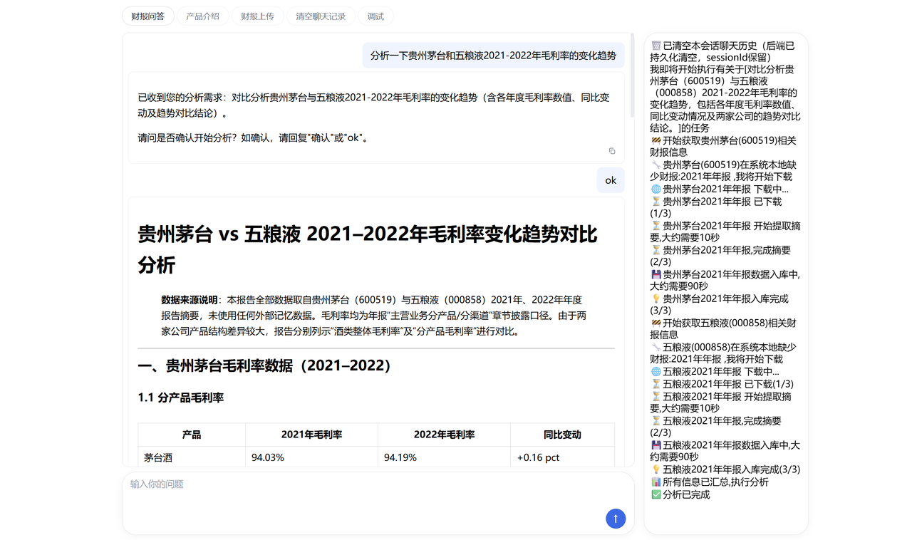

# 善财 (ShanCai) - 面向 A 股的财报智能分析 Agent

> 基于 LangGraph 构建的多轮对话财报分析系统。拒绝新闻舆情，拒绝大模型幻觉，所有结论基于法定财报原文，并强制页码溯源。

[](https://www.python.org/)
[](https://fastapi.tiangolo.com/)
[](https://langchain-ai.github.io/langgraph/)
[](https://qdrant.tech/)

## 📖 项目简介

《善财》是一款面向A股上市公司财报的智能分析助手。可以帮用户自动获取公开的A股上市公司年报、中报数据，并做财报分析，比如：
- 多公司横向对比（如：对比2022‑2024年茅台和五粮液的营收情况）
- 多年份纵向对比（如：分析2022‑2024年茅台的毛利率变化）
- 单份财报分析 （如：总结宁德时代2025年年报中，技术研发投入的情况）
- 提取财务指标、经营情况、管理层讨论、风险提示、审计报告、高管薪酬、业务板块等信息
您输入具体需求后，我会从自动外部系统下载涉及的公司财报，或从本地已归档财报信息中，提取相应内容进行分析和输出Markdown格式的报告。
交互形式为聊天式交互，用户可以在聊天框输入分析诉求，app利用大模型结合上下文来对解答用户的财报提问诉求。

**核心差异化**：
- **开放式多轮对话**：结合上下文消解指代（如“分析茅台” -> “换成五粮液看2023年”）。
- **多股并发分析**：底层基于 LangGraph `Send` API 实现 Fan-out/Fan-in，极速完成多公司、跨年份数据收集。
- **高置信度溯源**：不引用任何外部新闻与大模型预训练记忆，所有数据强制标注财报原文章节与页码。
- **沉浸式任务反馈**：WebSocket 实时推送执行进度，右侧状态栏与耗时预估消除等待焦虑。

👉 **[📚 产品需求与技术设计文档]([https://my.feishu.cn/wiki/KdDGw64CyioM71kEuZNcK1qTnmg])**

---

## 📸 界面预览



---

## 🏗️ 架构设计与核心技术

本项目采用**前后端分离 + 事件驱动**架构，后端核心 Agent 流转完全基于 **LangGraph** 的显式状态图（StateGraph）手工编排。

### 1. 核心 Agent 编排
- **`CAgentAdvisor`**：总控 Agent。唯一对接用户的入口，管理多轮对话状态，拦截/分发任务。
- **`CAgentIntent`**：意图解析。结合长上下文提取用户真实诉求（输出 `analysis_demand` 结构化文本）。
- **`CAgentOrchestrator`**：任务拆解。将宏观的对比诉求拆解为单股子任务，汇总最终报告。
- **`CAgentSingleStock`**：数据收集。检测本地数据完整性，调度下载与解析。

### 2. Fan-out / Fan-in 并发机制
在单股财报处理流程中，**业务代码中未出现任何 `ThreadPool` 等多线程 API**，而是完全利用 LangGraph 的并行调度能力：
1. **Fan-out**：动态生成 `List[Send]`，为每份缺失财报派发一个 Worker。
2. **Worker 独立执行**：各自完成“生成摘要 → 本地存盘 → RAG 向量化”。
3. **Fan-in 合并**：使用 `Annotated[List[...], add]` Reducer，将并发的状态自动合并入全局 State。

*(注：由于部署在轻量服务器，代码中通过 `max_concurrency` 对并发度做了保守限制，未来可平滑扩容)*

### 3. RAG 策略与防串台
- **物理隔离**：一份财报对应 Qdrant 中的一个独立 Collection，彻底避免跨公司检索串台。
- **页码补偿机制**：在 TextSplitter 切分时注入自定义页码标记，召回时通过正则匹配还原页码，确保前端能精准定位财报原文。

---

## 🚀 快速启动 (本地部署)

### 1. 环境准备
- Python 3.10+
- [Qdrant](https://qdrant.tech/) (向量数据库，请先启动本地服务)

- 大模型 API (支持 DeepSeek / 本地 Ollama)

### 2. 安装依赖
```bash
git clone https://github.com/youngsdikode1/FinancialReportAnalyse.git
cd FinancialReportAnalyse
pip install -r requirements.txt
```

### 3. 配置环境变量
在项目根目录创建 config.json（可参考根目录的 config.example.json）：

```json
{
  "llm_url": "http://127.0.0.1:11434",
  "llm_model_name": "qwen3.5:9b",
  "deepseek_llm_url": "https://api.deepseek.com/v1",
  "deepseek_llm_model_name": "deepseek-chat",
  "deepseek_key": "你的DeepSeek API Key",
  "datasinking_key": "你的DataSinking Key",
  "data_dir": "./datas",
  "use_deepseek_only": true
}
```

### 4. 启动服务
python3 fastapi-main.py
浏览器访问 http://127.0.0.1:8000 即可体验。