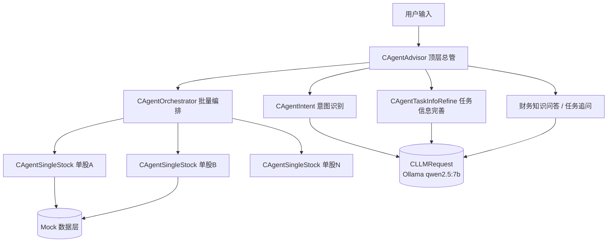
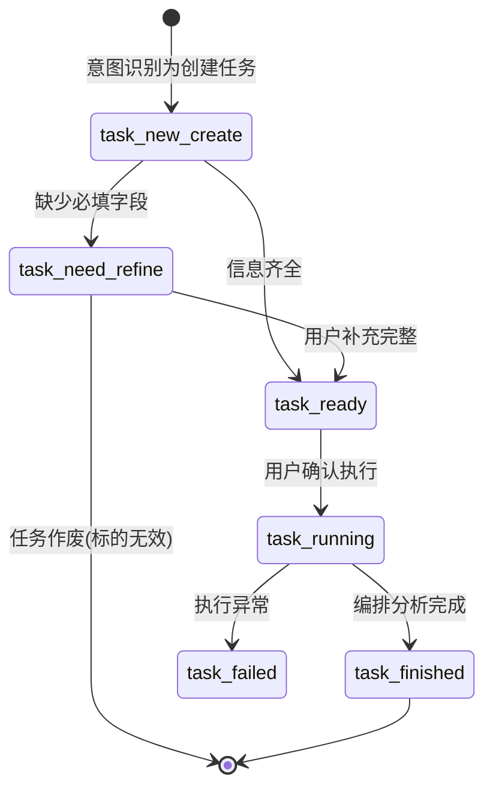
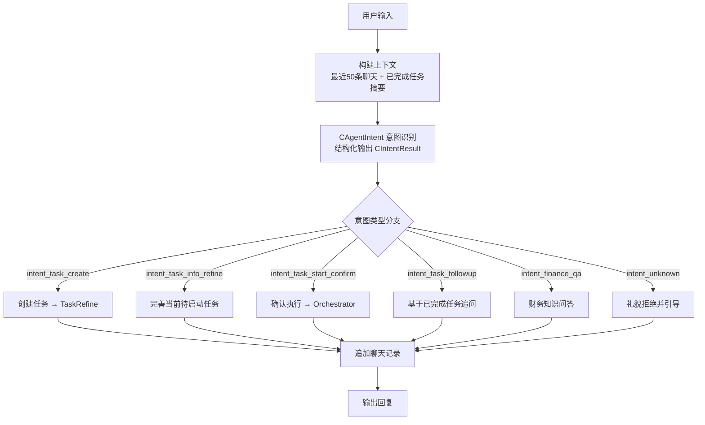
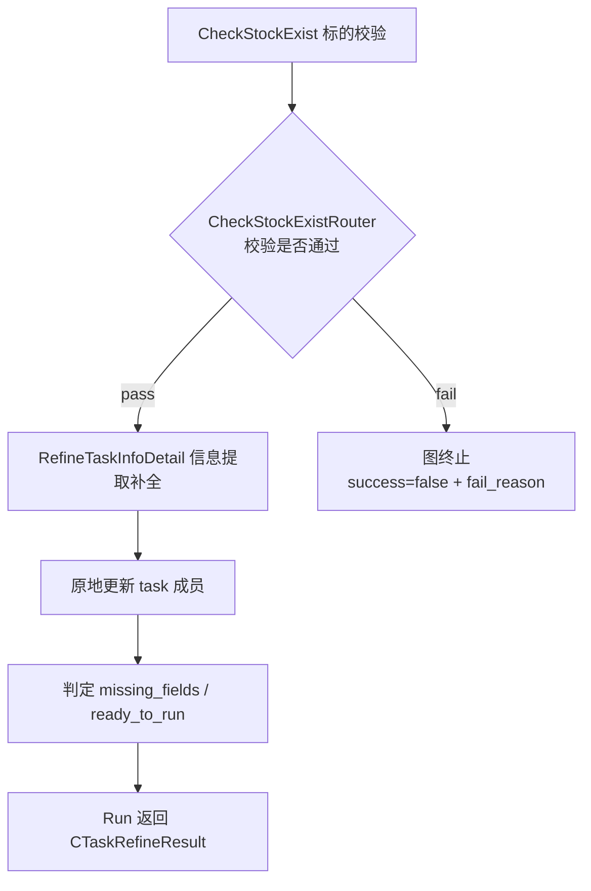
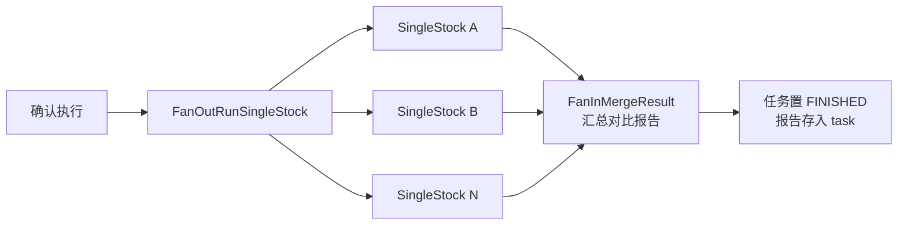
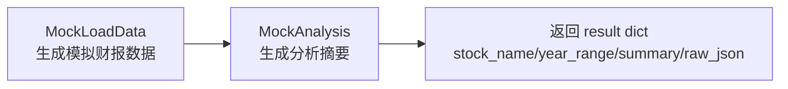

# 财报分析多 Agent 系统 — 技术设计文档

| 项目名称 | 财报分析多 Agent 系统（FinancialReportAnalyse） |
| --- | --- |
| 文档版本 | v1.0 |
| 编写日期 | 2026-09-28 |
| 当前阶段 | Mock Demo（业务链路已验证，数据层为模拟数据） |
| 关联文档 | 《财报分析 Agent 产品需求文档》 |

---

## 1. 文档概述

### 1.1 项目背景

面向价值投资人群与财务人员，通过开放式聊天指令，对单个 / 多个上市公司财报进行分析、整理与对比，支持对已完成任务的追问与财务知识问答。

核心差异化：
- 多标的、跨时间段批量分析（横向比较，识别优劣与行业趋势）；
- 开放式对话引导，而非封闭式"输入代码出结果"；
- 仅基于法定披露财报数据做分析，不引入新闻舆情、不依赖模型预训练记忆，保证数据高置信度，过程可追溯。

### 1.2 文档目标

说明当前 Mock Demo 的**技术选型、系统架构、核心设计模式、数据模型、核心流程与关键设计决策**，作为开发基线文档与面试技术讲解依据。

---

## 2. 技术选型

| 层次 | 选型 | 说明 |
| --- | --- | --- |
| 开发语言 | Python 3.12 | 类型标注 + TypedDict + 现代语法 |
| LLM 接入框架 | LangChain（`langchain-ollama` 的 `ChatOllama`） | 统一对话模型与结构化输出封装 |
| 编排框架 | LangGraph（`StateGraph`） | 多 Agent 状态机编排、子图、条件路由、Fan-out/Fan-in |
| 数据校验 | Pydantic v2 | 状态模型、结构化输出 Schema、运行时校验 |
| 本地推理 | Ollama + `qwen2.5:7b` | 业务层 LLM 调用走内网本地推理，不依赖外部 API |
| 数据层 | Mock 模拟数据 | 当前阶段用假财报数据跑通业务链路，后续替换真实数据源 |
| 交付形态 | 命令行交互（CMD Demo） | 便于演示与调试 |

> Ollama 服务地址：`http://192.168.1.25:11434`，模型：`qwen2.5:7b`。

---

## 3. 系统架构

### 3.1 总体架构



### 3.2 分层职责

| 层 | 组件 | 职责 |
| --- | --- | --- |
| 交互层 | `CAgentAdvisor` | 意图分发、上下文管理、任务生命周期管理、**用户话术组装**（唯一生成自然语言回复的层） |
| 认知层 | `CAgentIntent` | 对用户最新一句话做意图分类 + 实体抽取（标的 / 年份 / 诉求） |
| 任务层 | `CAgentTaskInfoRefine` | 标的上市主体校验、任务信息提取与补全、就绪度判定 |
| 编排层 | `CAgentOrchestrator` | 多标的 Fan-out 并行调用单股 Agent，Fan-in 汇总生成对比报告 |
| 执行层 | `CAgentSingleStock` | 单股财报数据加载与分析（当前为 Mock） |
| 基础设施 | `CLLMRequest` | LLM 文本调用 / 结构化输出调用的统一封装，调试日志与 token 估算 |

---

## 4. 核心设计模式

本系统的技术骨架由以下 6 个设计决策构成：

### 4.1 Agent 即类，内部各自持有独立 LangGraph 子图

每个 Agent 封装为一个类，类内部 `BuildGraph()` 构建自己的子图，`Run()` 作为对外入口。

```python
class CAgentIntent:
    def __init__(self):
        self.m_graph = self.BuildGraph()          # 内部私有子图
    def BuildGraph(self): ...                     # 节点 + 边 + 条件路由
    def Run(self, ...): ...                       # 对外入口
```

- 高内聚：Agent 的状态、节点、路由、入口全在一个类内；
- 低耦合：上层不关心子图内部结构，只调用 `Run()`；
- 可替换：每个 Agent 可独立测试、独立演进。

### 4.2 下层返回结构化结果，上层组装用户话术

**子 Agent 严禁生成面向终端用户的自然语言提示**，只输出结构化状态（Pydantic 模型）；由 `CAgentAdvisor` 根据结构化字段自行拼接话术。

```python
# 下层 CAgentTaskInfoRefine 输出：
class CTaskRefineResult(BaseModel):
    success: bool
    fail_reason: Optional[str] = None
    missing_fields: List[str] = Field(default_factory=list)
    ready_to_run: bool = False

# 上层 CAgentAdvisor 依据字段分支拼接提示语
if not refine_result.success:
    return f"{refine_result.fail_reason}。请提供准确上市公司名称或股票代码。"
```

- 职责解耦：交互文案收敛在总管，改话术不动业务逻辑；
- 可测试性：单测直接校验返回字段，无需解析自然语言；
- 便于流程分支：`success / missing_fields / ready_to_run` 直接驱动上层决策。

### 4.3 任务实体原地修改，不返回新对象

`CAgentTaskInfoRefine.Run(task, user_query)` **直接修改传入的 `CTaskAnalysis` 实例成员**，结构化返回中不携带 task 字段，避免对象拷贝与状态漂移。

```python
task.m_target_companies = check.valid_names   # 原地更新
task.m_year_range = detail.year_range         # 原地更新
```

### 4.4 LLM 请求临时实例化，默认参数开箱即用

`CLLMRequest` 构造函数全参数带默认值；各 Agent 在**需要调用 LLM 的节点函数内部临时创建实例**，不长期持有，用完即释放。

```python
class CLLMRequest:
    def __init__(self, base_url: str = OLLAMA_BASE_URL,
                 model_name: str = OLLAMA_MODEL_NAME,
                 timeout: int = 30, bDebugLog: bool = False): ...

# 调用处（节点内临时创建）
llmRequest = CLLMRequest()
resp = llmRequest.Invoke(prompt)
```

- 内存干净：Agent 类本身不绑定 LLM 实例，LLM 只是临时工具；
- 灵活切换：需要换模型 / 开调试日志时，调用处显式传参即可。

### 4.5 状态机驱动任务生命周期

任务状态贯穿创建 → 完善 → 就绪 → 执行 → 完成，由 `CTaskAnalysis.m_status` 唯一权威维护，上层据此分发意图与分支决策。

### 4.6 LLM 结构化输出（Structured Output）

意图识别、标的校验、信息提取三类认知任务均通过 `ChatOllama.with_structured_output(schema)` 强制模型按 Pydantic Schema 输出，从源头消除"模型输出自由文本 → 正则解析"的不稳定性。

---

## 5. 数据模型设计

### 5.1 意图类型（6 类）

| 常量 | 含义 |
| --- | --- |
| `intent_task_create` | 创建新的财报分析任务 |
| `intent_task_info_refine` | 对未启动任务补充 / 完善信息 |
| `intent_task_followup` | 对已完成任务追问 |
| `intent_task_start_confirm` | 用户确认，开始执行就绪任务 |
| `intent_finance_qa` | 财务名词 / 股票常识问答 |
| `intent_unknown` | 超出范围意图 |

> 分类硬性约束：凡要求"分析 XX 公司 XX 年财报/业绩"，必须归为 `intent_task_create`，不得落入 `intent_finance_qa`；`reason` 字段仅基于本次输入。

### 5.2 任务状态机（6 状态）



| 状态 | 含义 |
| --- | --- |
| `task_new_create` | 任务刚创建，进入标的校验 |
| `task_need_refine` | 缺失必填信息，等待用户补充 |
| `task_ready` | 信息齐全，等待确认启动 |
| `task_running` | 任务执行中 |
| `task_finished` | 已完成，支持追问 |
| `task_failed` | 失败 |

### 5.3 任务类型（3 类）

| 常量 | 含义 |
| --- | --- |
| `single_stock` | 单标的分析 |
| `multi_stock` | 多标的批量比较 |
| `sector` | 板块 / 行业分析 |

### 5.4 结构化输出 Schema（4 个 Pydantic 模型）

| 模型 | 用途 | 关键字段 |
| --- | --- | --- |
| `CIntentResult` | 意图识别结果 | `intent_type`、`reason`、`target_stocks`、`year_range`、`raw_analysis_demand` |
| `CTaskRefineResult` | 任务完善结果（返回上层） | `success`、`fail_reason`、`missing_fields`、`ready_to_run` |
| `CStockCheckResult` | 标的校验结果（子图内） | `is_valid`、`msg`、`valid_names` |
| `CTaskInfoDetail` | 任务信息提取结果（子图内） | `target_companies`、`year_range`、`analysis_requirement`、`task_type`、`missing_fields`、`ready_to_run` |

### 5.5 LangGraph State 定义（4 个 TypedDict）

| State | 所属 Agent | 关键字段 |
| --- | --- | --- |
| `CAgentIntentState` | 意图识别 | `context_text`、`current_task_status`、`user_query`、`intent_result` |
| `CAgentTaskRefineState` | 任务信息完善 | `current_task`、`stock_check_result`、`success`、`fail_reason`、`missing_fields`、`ready_to_run` |
| `CSingleStockState` | 单股分析 | `stock_code`、`year_range`、`mock_fin_json`、`mock_summary`、`mock_vector_info`、`result` |
| `COrchestratorState` | 批量编排 | `stock_list`、`year_range`、`analysis_requirement`、`sub_task_results`、`final_report` |

### 5.6 核心业务实体 `CTaskAnalysis`

任务生命周期唯一载体，贯穿创建到完成：

```python
class CTaskAnalysis:
    m_task_id: str                          # 任务 ID
    m_status: str                           # 任务状态（见 5.2）
    m_target_companies: List[str]           # 目标标的列表
    m_analysis_requirement: str             # AI 加工后的标准化分析诉求
    m_task_type: Optional[str]              # 任务类型（见 5.3）
    m_year_range: Optional[str]             # 分析年份范围
    m_full_analysis_result: Optional[str]   # 最终分析报告
```

---

## 6. 核心流程设计

### 6.1 总入口流程（CAgentAdvisor.HandleUserInput）



上下文构成：
- 最近 50 条聊天记录（`MAX_CONTEXT_RECORDS = 50`，超出截断）；
- 本会话已完成任务的简要信息（taskId / 状态 / 标的 / 诉求）。

### 6.2 任务创建与信息完善流程（CAgentTaskInfoRefine 子图）



1. **标的校验（CheckStockExist）**：LLM 判断标的是否为 A 股 / 港股上市主体，解析 `CStockCheckResult`；无效或解析失败 → `success=false`，携带失败原因（如"贵州茅台 不是A股上市公司，查询不了信息"）；通过 → 原地更新 `task.m_target_companies` 为标准化全称；
2. **条件路由**：校验失败直接终止子图，不进入信息提取；
3. **信息提取（RefineTaskInfoDetail）**：LLM 提取年份、诉求、任务类型，原地回填 `task`；计算缺失字段与就绪度；
4. **返回上层**：`CTaskRefineResult(success, fail_reason, missing_fields, ready_to_run)`。

上层 `HandleTaskCreate` 的分支处理：

| 结构化字段 | 上层动作 |
| --- | --- |
| `success = false` | 作废当前任务（`m_current_task = None`），输出失败原因并引导重新提供标的 |
| `missing_fields` 非空 | 任务置 `NEED_REFINE`，提示用户补充缺失字段 |
| `ready_to_run = true` | 任务置 `READY`，复述任务信息，询问用户"确认开始执行吗？" |

> 前置保护：意图识别出的 `target_stocks` 为空时，直接在 `HandleTaskCreate` 返回提示，不进入子 Agent。

### 6.3 多标的批量分析流程（CAgentOrchestrator：Fan-out / Fan-in）



1. 任务状态 `READY → RUNNING`；
2. `FanOutRunSingleStock`：遍历 `stock_list`，逐个调用 `CAgentSingleStock.Run()`，结果收集到 `sub_task_results`；
3. `FanInMergeResult`：按标的生成 Markdown 汇总报告（`# 多标的财报汇总分析报告` + 各标的摘要）；
4. 报告写入 `task.m_full_analysis_result`，任务置 `FINISHED` 并归档到 `m_task_list`，`m_current_task` 清空。

### 6.4 单股分析流程（CAgentSingleStock 子图）



当前为 Mock 实现：
- `mock_fin_json`：模拟营收 / 净利润 / ROE 结构化数据；
- `mock_summary`：模拟经营情况摘要文本；
- `mock_vector_info`：模拟年报向量分片（为后续 RAG 检索预留结构）。

### 6.5 任务追问流程（HandleTaskFollowUp）

1. 从 `m_task_list` 逆序查找最近一个 `FINISHED` 任务；
2. 基于该任务的 `m_full_analysis_result` + 对话上下文，调用 LLM 回答追问；
3. 无已完成任务时给出明确提示。

---

## 7. 关键设计决策（设计取舍记录）

| # | 决策 | 理由 | 代价 / 后续 |
| --- | --- | --- | --- |
| 1 | 每个 Agent 内部独立 LangGraph 子图 | 高内聚低耦合，可独立测试；上层只依赖 `Run()` 接口 | 子图间状态不共享，需通过返回值传递 |
| 2 | 子 Agent 只返回结构化结果，不生成用户话术 | 文案收敛于总管，改交互不改逻辑；单测友好 | 上层需维护多分支文案 |
| 3 | 任务实体原地修改（引用传递） | 避免对象拷贝与状态漂移，单一数据源 | 调用方需注意引用副作用 |
| 4 | LLM 请求临时实例化 + 默认参数 | 不长期持有 LLM 对象，内存干净；换模型/IP 灵活 | 高频调用有少量重复初始化开销 |
| 5 | 关键认知任务全部走结构化输出 | 消除自由文本 → 正则解析的不稳定性 | 对模型结构化能力有要求（7B 偶发抽取失败，已加前置保护） |
| 6 | 业务层 LLM 用本地 Ollama | 演示不依赖外网，面试可本地运行；数据不出内网 | 长上下文性能有限（64K 内为宜） |
| 7 | 标的校验由 LLM 完成 | 保持通用性，不硬编码白名单 | 7B 模型偶发幻觉，生产环境应替换为证券数据源校验 |

---

## 8. 运行环境与部署

### 8.1 依赖

```text
Python 3.12
langchain
langchain-ollama
langgraph
pydantic>=2.x
```

### 8.2 运行前置条件

1. 内网机器 `192.168.1.25` 已部署 Ollama，且拉取模型 `qwen2.5:7b`；
2. Ollama 服务需监听局域网：`OLLAMA_HOST=0.0.0.0` 后重启服务，否则外部主机无法连接；
3. 运行环境与 Ollama 网络可达（端口 11434）。

### 8.3 启动方式

```bash
python mockdemo.py
```

### 8.4 典型验证输入

| 输入 | 预期链路 |
| --- | --- |
| `分析一下贵州茅台2023年财报` | 意图 `intent_task_create` → 标的校验 → 信息提取 → 任务确认提示 |
| `确认执行` | 意图 `intent_task_start_confirm` → Orchestrator 批量分析 → 输出汇总报告 |
| `帮我解释什么是ROE` | 意图 `intent_finance_qa` → 财务知识问答 |
| `exit` | 退出程序 |

---

## 9. 与需求文档的映射

| 需求功能（需求文档） | 技术实现 |
| --- | --- |
| 单股财报分析 | `CAgentSingleStock`（Mock）+ Orchestrator 单标的路径 |
| 多股 / 跨时间段批量分析 | `CAgentOrchestrator` Fan-out/Fan-in 汇总报告 |
| 对已完成任务追问 | `HandleTaskFollowUp` 基于 `m_full_analysis_result` 二次问答 |
| 财务知识问答 | `HandleFinanceQA` |
| 开放式意图识别 | `CAgentIntent` 6 类意图分类 + 实体抽取 |
| 参数确认与容错（缺年份、标的名错误） | `CTaskRefineResult.missing_fields` 驱动追问；标的校验失败作废任务 |
| 数据仅来自财报、不引入舆情 | 当前 Mock 数据层为纯财务指标；生产化由数据源边界保证 |
| 任务过程可视化 | 右侧状态面板对应 LangGraph 节点级状态（后续前端接入） |

---

## 10. 生产化演进路线

| 阶段 | 内容 |
| --- | --- |
| 阶段一（当前） | Mock 数据跑通全链路：意图识别 → 标的校验 → 信息完善 → 编排分析 → 追问 |
| 阶段二 | 标的校验接入外部证券数据源（如交易所公告 / 证券信息 API），替换 LLM 幻觉判断 |
| 阶段三 | 单股 Agent 接入真实财报数据源：财报文件解析 → 结构化指标 → 向量分片入库 |
| 阶段四 | 批量分析接入向量检索（RAG），分析结论可溯源到具体财报科目 |
| 阶段五 | 前端对话界面 + 右侧任务状态面板（对应 LangGraph 节点级执行日志） |
| 阶段六 | 审计意见预警：分析前识别年报审计意见类型，非标准意见醒目提示 |

---

## 附录 A：代码文件结构（mockdemo.py）

| 代码段 | 内容 |
| --- | --- |
| 全局常量 | 意图常量、任务状态常量、任务类型、Ollama 配置 |
| `CLLMRequest` | LLM 文本 / 结构化调用统一封装 |
| State 定义 | 4 个 LangGraph TypedDict |
| Pydantic Schema | `CIntentResult` / `CTaskRefineResult` / `CStockCheckResult` / `CTaskInfoDetail` |
| `CTaskAnalysis` | 任务生命周期实体 |
| `CAgentTaskInfoRefine` | 标的校验 + 信息提取子图 |
| `CAgentSingleStock` | 单股 Mock 分析子图 |
| `CAgentOrchestrator` | Fan-out / Fan-in 编排子图 |
| `CAgentIntent` | 意图识别子图 |
| `CAgentAdvisor` | 顶层总管：意图分发、任务管理、话术组装 |
| `Main()` | CMD 交互入口 |
